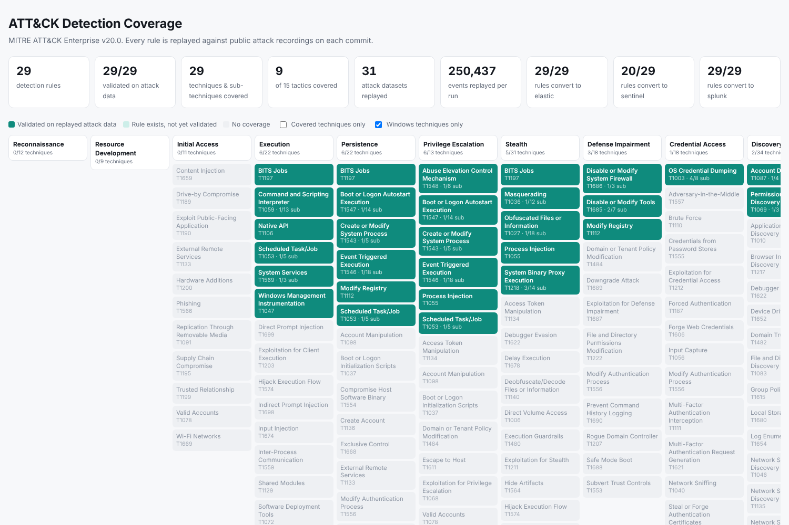
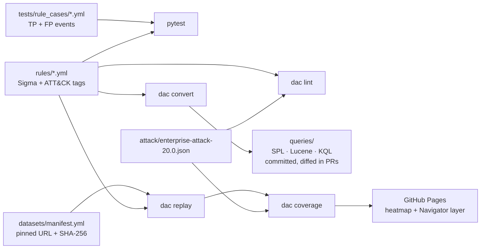

# Detection-as-Code Pipeline

[](https://github.com/DaveyD347/Detection-as-Code-Pipeline/actions/workflows/ci.yml)

Detection rules treated like production code. Every rule is a [Sigma](https://sigmahq.io)
file mapped to MITRE ATT&CK, and every pull request has to prove three things before it merges:

1. **It detects the attack.** The rule is replayed against real attack recordings from public
   datasets and must fire on the ones it claims to cover.
2. **It stays quiet otherwise.** The same replay runs every rule over every other dataset; any
   hit nobody expected fails the build until it is triaged as a true positive or fixed.
3. **It deploys everywhere.** The rule is converted to Splunk SPL, Elastic Lucene and Microsoft
   Sentinel KQL, the generated queries are committed so reviewers see the diff, and the
   conversions go through semantic checks because the converters are not always right.

Coverage is published as an ATT&CK heatmap that only counts a technique as covered once a rule
for it has fired on real attack data.



| | |
|---|---|
| Rules | 29 Sigma rules across 9 ATT&CK tactics (Windows: Sysmon, Security, System) |
| Validation | 29/29 rules fire on replayed attack data; 0 unexplained hits across 31 datasets / 250k events |
| Unit cases | 128 hand-written true/false-positive events, including evasion variants |
| SIEM targets | Splunk 29/29 · Elastic 29/29 · Sentinel 20/29 ([why not 29](config/conversion.yml)) |
| ATT&CK | Pinned to Enterprise **v20.0**, including the Stealth / Defense Impairment split |

## How it works



| Stage | What it checks | Fails the build when |
|---|---|---|
| `dac lint` | pySigma structural validators; required metadata; ATT&CK tags against the pinned release; folder = tactic; file prefix = logsource; unit cases present; regex portability | anything is wrong, e.g. a revoked technique (`T1562.002 is revoked in ATT&CK v20.0; use attack.t1685.001`) |
| `pytest` | replay-engine semantics for every Sigma modifier, plus each rule's TP/FP cases | a rule misses an evasion variant or fires on a look-alike |
| `dac replay` | every rule × every dataset in the manifest | an expected detection is missed, or any rule fires where it was not expected |
| `dac convert --check` | conversion to all three SIEMs + semantic checks on the output | a conversion breaks, a known gap starts working, or `queries/` is stale |
| `dac coverage` | builds the heatmap site and an [ATT&CK Navigator](https://mitre-attack.github.io/attack-navigator/) layer | (report only) |

### The replay engine

SIEMs are not available in CI, so `src/dac/engine.py` evaluates Sigma locally. It does not
re-implement Sigma parsing: pySigma parses the rule and applies every modifier (`|contains`,
`|windash`, `|all`, `|cidr`, `|re`, ...), and the engine compiles the resulting condition tree
into Python predicates. Anything it cannot evaluate faithfully (placeholders, correlation
rules) raises an error instead of guessing.

How a Sigma `logsource` maps onto raw events is spelled out in
[`src/dac/data/logsources.yml`](src/dac/data/logsources.yml), for example
`process_creation` = Sysmon EID 1 **or** Security 4688 with `NewProcessName` mapped to `Image`.
That is the same job a SIEM processing pipeline does, written down where it can be reviewed.

The whole corpus replays over 250k events in about 15 seconds.

### Datasets

Attack telemetry comes from [OTRF Security-Datasets](https://github.com/OTRF/Security-Datasets)
(MIT): recordings of Empire, Covenant, Mimikatz, Dumpert, Atomic Red Team and hands-on-keyboard
techniques on lab hosts with normal background noise. Nothing is vendored. Each entry in
[`datasets/manifest.yml`](datasets/manifest.yml) pins an immutable commit URL and a SHA-256;
downloads that do not match are rejected, and the CI cache is content-addressed and re-verified.

## What the pipeline caught while it was being built

These are real findings from building this repo, and the reason each stage exists.

- **.NET noise in an LSASS rule.** The first version of
  [`proc_access_lsass_unbacked_calltrace`](rules/windows/credential_access/proc_access_lsass_unbacked_calltrace.yml)
  matched any `UNKNOWN` frame in a Sysmon call stack. Replay flagged 58 unexpected hits from the
  Azure guest agent, a PowerShell remoting host and Task Manager: managed code shows `UNKNOWN`
  (JIT) frames deep in the stack. The rule now requires the *direct* caller of `OpenProcess` to be unbacked,
  which still catches in-memory Mimikatz and drops the noise.
- **Subkeys aren't hives.** `reg export HKLM\SYSTEM\CurrentControlSet\...` from background
  activity tripped the "credential hive saved" rule. It now only matches whole `SAM`, `SECURITY`
  and `SYSTEM` hives.
- **A converter bug.** pySigma's Defender XDR pipeline turned `TargetObject|contains: '...\Run\'`
  into `RegistryKey endswith "...\Run*"`. In KQL that `*` is a literal character, so the
  Sentinel query could never match. A semantic check on generated KQL now fails the build on
  this pattern.
- **Silent schema mismatches.** Sysmon writes registry data as `DWORD (0x00000004)`; Defender
  stores `4`. The converted Sentinel query was valid KQL that would never fire. Also caught by a
  semantic check, and recorded as a [known gap](config/conversion.yml) rather than shipped.
- **Dialect drift.** Splunk has no single-character wildcard, so the Splunk backend widens `?`
  to `*`. Lucene regex is implicitly anchored and has no `\s`, `\d` or `\b`. `dac lint` flags
  both, and the one regex in the corpus is written to behave identically in PCRE, RE2 and Lucene.
- **ATT&CK moved.** v20 revoked the whole T1562 *Impair Defenses* family in favour of the new
  *Defense Impairment* tactic (T1685, T1686) and renamed Defense Evasion to *Stealth*. Lint
  validates tags against the pinned release and names the replacement for revoked IDs.

## Repository layout

```
rules/windows/<tactic>/      Sigma rules; folder must be one of the rule's ATT&CK tactics
tests/rule_cases/            per-rule true/false-positive events (one file per rule)
tests/unit/                  engine semantics, lint gates, rule cases
datasets/manifest.yml        pinned attack datasets and the detections each must produce
attack/                      compact ATT&CK catalog generated from the pinned STIX bundle
config/conversion.yml        documented conversion gaps per SIEM
queries/                     generated SPL / Lucene / KQL (+ savedsearches.conf, Elastic
                             NDJSON, Sentinel analytics rules). Do not edit by hand.
src/dac/                     the toolkit (lint, engine, replay, convert, coverage, CLI)
```

## Running it locally

```bash
python -m venv .venv && . .venv/bin/activate
pip install -c requirements.lock -e '.[dev]'

dac lint                 # rule quality gates
pytest                   # engine + rule unit cases
dac replay               # downloads and verifies datasets on first run (~20 MB), writes build/replay.md
dac convert              # regenerate queries/
dac coverage             # build/site/index.html
```

See [CONTRIBUTING.md](CONTRIBUTING.md) for the workflow to add a rule.

## Deploying the output

- **Splunk:** `queries/splunk/savedsearches.conf` and `macros.conf`. Every search starts with a
  data-source macro such as `` `dac_windows_process_creation` ``, so index and sourcetype
  differences are fixed in one place.
- **Elastic:** import `queries/elastic/detection_rules.ndjson` in Security → Rules (rules are
  disabled on import, with ATT&CK threat mappings from the pinned catalog).
- **Sentinel:** `queries/sentinel/analytics_rules.yaml` holds scheduled analytics rules for the
  Defender XDR (`Device*`) and `SecurityEvent` tables.

Pushing to the SIEMs automatically is deliberately out of scope: that needs credentials and an
environment, and is the natural next stage (`dac deploy --target splunk` behind a protected
GitHub environment).

## Limitations

- Replay proves a rule fires on a recorded attack and is quiet on the background noise of 31
  lab captures. It is not a substitute for tuning against your own production baseline.
- The engine evaluates single-event rules. Sigma correlation rules are rejected, not approximated.
- Nine rules have no faithful Sentinel translation today; each has a written reason in
  [`config/conversion.yml`](config/conversion.yml).

## Credits

Attack data: [OTRF Security-Datasets](https://github.com/OTRF/Security-Datasets) (MIT).
ATT&CK® is a registered trademark of The MITRE Corporation; technique data from
[mitre-attack/attack-stix-data](https://github.com/mitre-attack/attack-stix-data).
Rule logic is original to this repository and informed by public research linked in each rule.
